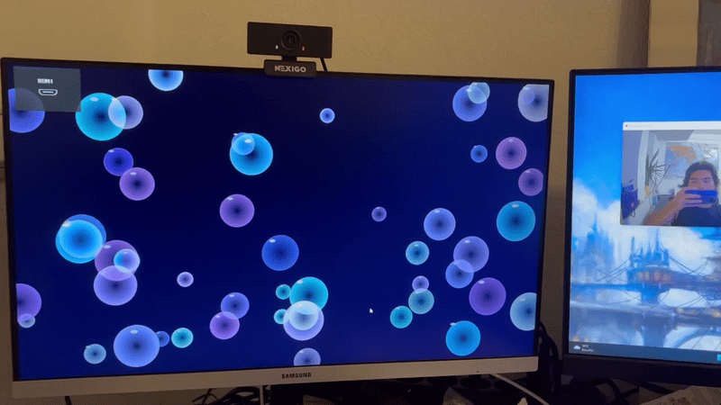

# MediaPipe Moving Bubbles

**Real-time hand-gesture-controlled bubble animation with dual-monitor support.**

An interactive human–computer interaction prototype combining **MediaPipe Hands**, **OpenCV**, **MSS screen capture**, and **Pygame**. The application recognizes the orientation of selected finger landmarks and steers a field of 50 animated bubbles in four directions. It was designed for a Windows dual-monitor setup: input is captured from a video displayed on the first monitor, while a borderless, always-on-top animation runs on the second monitor.

## Demo


The animation demonstrates real-time hand gesture recognition and bubble motion control using MediaPipe and Pygame.


## Features

- **Four directional commands:** left, right, up, and down, inferred from MediaPipe hand landmarks.
- **50 independently rendered bubbles:** varied sizes, colors, transparency, and speeds.
- **Dual-display setup:** video/source content on the primary display; animation on the second display if available.
- **Always-on-top borderless animation:** Windows `SetWindowPos` keeps the bubble display visible without intentionally activating it.
- **Gesture loss tolerance:** the most recent command is retained for up to **0.6 s** after detection stops.
- **Smooth idle transition:** bubbles gradually slow to **one-third of their controlled speed**, then choose a random drifting direction.
- **Boundary handling:** bubbles stay inside the animation window and bounce while drifting.

## How it works

```text
Video visible in first monitor (top-left capture region)
      |
      v
MSS screen capture (1024 x 780, starting at x=0, y=0)
      |
      v
OpenCV: BGRA -> BGR -> RGB
      |
      v
MediaPipe Hands: landmarks + handedness
      |
      v
Left-hand finger-vector thresholding (up/down/left/right)
      |
      v
0.6 s gesture-loss tolerance + idle deceleration
      |
      v
Pygame: 50 moving bubbles on a borderless display
```

**Technical note:** direction is derived from the relative geometry of the index, middle, and ring fingers (selected landmark pairs), **not** from the measured displacement of the hand between consecutive frames. MediaPipe handedness labels assume a mirrored/selfie-style input; verify the intended left-hand label with your video setup.

## Requirements

- **Windows** (the always-on-top feature uses the Windows API via `ctypes`).
- A **Python 3.11** environment is recommended for this original implementation.
- One monitor works; **two extended displays** are recommended.
- A video/camera preview containing the hand, visible within the screen-capture region.
- Dependencies in [`requirements.txt`](requirements.txt).

> Compatibility: this script uses the legacy `mp.solutions.hands` interface. Newer MediaPipe releases removed that interface; therefore the example requirements pin `mediapipe==0.10.21`. This package combination is suggested for reproducibility but has **not** been tested against every Windows setup.

## Installation

```powershell
# Run in the project directory
py -3.11 -m venv .venv
.venv\Scripts\activate
python -m pip install -r requirements.txt
```

## Run

1. In Windows display settings, select **Extend these displays** if two monitors are connected.
2. Show the live input video on your **first monitor**, in the **top-left 1024 x 780 pixel region**.
3. Start the application:

```powershell
python moving_bubbles.py
```

4. Use the **left hand** to make the four directional gestures. If no qualifying gesture is detected for more than 0.6 seconds, bubbles gradually transition back to random drift.
5. Press **Esc** when the Pygame window has keyboard focus to exit (or use **Ctrl+C** in the terminal).

## Configuration

The supplied Python source is preserved without refactoring. Modify the following constants in `moving_bubbles.py` for your setup:

| Setting | Original value | Purpose |
| --- | --- | --- |
| `NUMBER_OF_BUBBLES` | `50` | Number of bubbles |
| `TARGET_FPS` | `30` | Target frames per second |
| `SCREEN_WIDTH`, `SCREEN_HEIGHT` | `1024`, `780` | Screen-capture width and height |
| `monitor_area` | top=0, left=0 | Captured screen region |
| `NO_GESTURE_TIMEOUT` | `0.6` | Retain last detected direction (s) |
| `FLOAT_SPEED_RATIO` | `1/3` | Desired idle/controlled speed ratio |
| `DECELERATION_FACTOR` | `0.97` | Per-update deceleration while idle |

### Limitations

- The input source is a **screen region**, not a direct webcam feed; the relevant video must be visible within that region.
- Gestures are evaluated for **MediaPipe's `Left` handedness label only**. Handedness can change with camera mirroring.
- The idle deceleration factor is applied per update, so real-time speed depends on frame timing.
- This prototype is tailored to Windows and has no automated tests or benchmark results in the current repository.

## Project files

```text
MediaPipe-Moving-Bubbles/
├── moving_bubbles.py   # Original implementation (unchanged)
├── README.md           # Overview, installation and operation
├── requirements.txt    # Python dependencies
├── .gitignore          # Files excluded from Git
└── media/
    └── README.md       # Video/GIF publishing instructions
```

## Attribution and licensing

Built using [MediaPipe](https://github.com/google-ai-edge/mediapipe), [OpenCV](https://opencv.org/), [Pygame](https://www.pygame.org/), [MSS](https://github.com/BoboTiG/python-mss), and NumPy. This repository does not yet include a software license; the project owner can select one before granting reuse rights.
